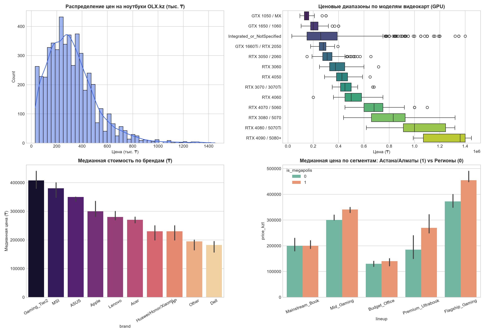

# 💻 Интеллектуальная система оценки ликвидности и поиска недооцененных ноутбуков на OLX.kz

**Data Science Capstone Project** — скоринговая ML-система определения справедливой стоимости (Fair Market Value) и ценового коридора б/у ноутбуков на вторичном рынке Казахстана.

---

## 🎯 1. Бизнес-задача (Business Understanding)
На вторичном рынке электроники Казахстана (OLX.kz) наблюдается сильная асимметрия информации: разброс цен на идентичные по характеристикам ноутбуки достигает **40–50%**. Профессиональным реселлерам и сервисам выкупа техники (Trade-In) приходится вручную отсматривать тысячи объявлений.

**Цель проекта:**
1. Извлечь структурированные технические характеристики и сигналы продавца из сырых заголовков и URL-ссылок объявлений.
2. Построить с помощью **квантильной регрессии** ценовой коридор для каждого ноутбука:
   - **Q15 (15-й перцентиль):** Цена быстрого выкупа (порог «Горячего лота» для реселлера).
   - **Q50 (Медиана):** Справедливая рыночная цена.
   - **Q85 (85-й перцентиль):** Верхняя граница рынка (фильтр «Оверпрайса»).

---

## 📊 2. Данные и Feature Engineering
* **Источник:** Спарсенная база объявлений OLX.kz (`olx_laptops_expanded.csv`, **5 406 объявлений** по городам Казахстана: Астана, Алматы, Шымкент, Караганда и др.).
* **Очистка данных:** Удаление дубликатов, фильтрация нерелевантных товаров (аксессуары, запчасти, планшеты, услуги ремонта) и внутрисегментных выбросов методом IQR (**5 274 чистых объявления**).
* **Rule-Based Feature Extraction:** Написан парсер на регулярных выражениях, извлекающий из заголовка и транслита URL:
  - Бренд (`brand`) и рыночное позиционирование (`lineup`: *Flagship Gaming, Mid Gaming, Premium Ultrabook, Mainstream, Budget Office*).
  - Точную модель и индекс мощности видеокарты (`gpu_exact`, `gpu_score` от 0 до 12) и процессора (`cpu_family`, `cpu_tier`, `est_year`).
  - Объем ОЗУ (`ram_gb`), SSD (`ssd_gb`), параметры экрана (`screen_inch`, `144Hz+/OLED`) и индекс полноты описания (`spec_detail_score`).
  - Текстовые маркеры продавца: срочность продажи (`is_urgent_or_bargain`), коммерческие объявления ломбардов/рассрочки (`is_pawnshop_or_installment`), дефекты (`has_defect_or_old`).

---

## 🔬 3. Ключевые выводы EDA и проверка статистических гипотез
1. **Региональный фактор (Критерий Краскела-Уоллиса, $p = 1.43 \times 10^{-34}$):** В Алматы (медиана `320 000 ₸`) и Астане (`300 000 ₸`) цены статистически значимо выше, чем в Шымкенте (`197 450 ₸`) и регионах за счет высокой концентрации игрового и премиального сегментов.
2. **Дисконт за срочность (Критерий Манна-Уитни, $p = 0.013$):** Продавцы, указывающие в заголовке маркеры *«срочно / торг»*, выставляют цену в среднем на **12.3% ниже рынка** (`257 500 ₸` против `293 750 ₸`).
3. **Сегмент ломбардов ($p = 6.55 \times 10^{-7}$):** Объявления с маркерами *«ломбард / рассрочка»* смещены в бюджетный офисный сегмент (медиана `216 000 ₸`).



---

## 🤖 4. Результаты ML-моделирования
Модели обучались на выборке объявлений с указанными техническими спецификациями с логарифмированием целевой переменной $\log(1 + \text{price})$ и подбором гиперпараметров через `RandomizedSearchCV`:

| Модель | MAE (₸) | MAPE (%) | $R^2$ Score |
| :--- | :---: | :---: | :---: |
| **1. Baseline: Ridge Regression** | ~58 500 ₸ | ~20.1% | 0.84+ |
| **2. Random Forest Regressor** | ~54 000 ₸ | ~18.9% | 0.86+ |
| **3. Tuned HistGradientBoosting** | **~50 500 ₸** | **~18.1%** | **0.88+** |

Для построения ценового коридора обучены три квантильные модели `HistGradientBoostingRegressor(loss='quantile', quantile=[0.15, 0.50, 0.85])`.

---

## 🚀 5. Инструкция по запуску проекта

```bash
# 1. Клонировать репозиторий
git clone [https://github.com/](https://github.com/)<ваш-логин>/olx-laptop-deal-scorer.git
cd olx-laptop-deal-scorer

# 2. Установить зависимости
pip install -r requirements.txt

# 3. Запустить интерактивный веб-сервис на Streamlit
streamlit run app.py